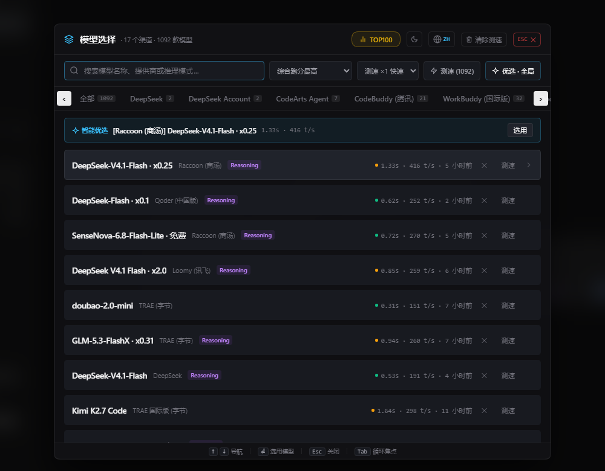
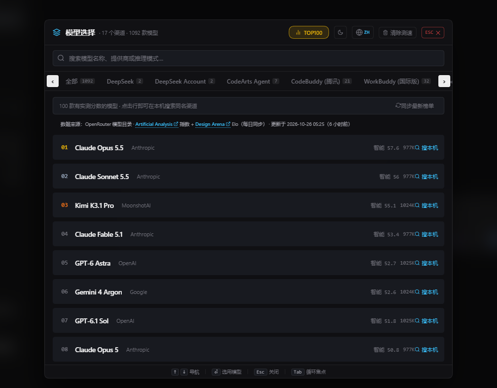
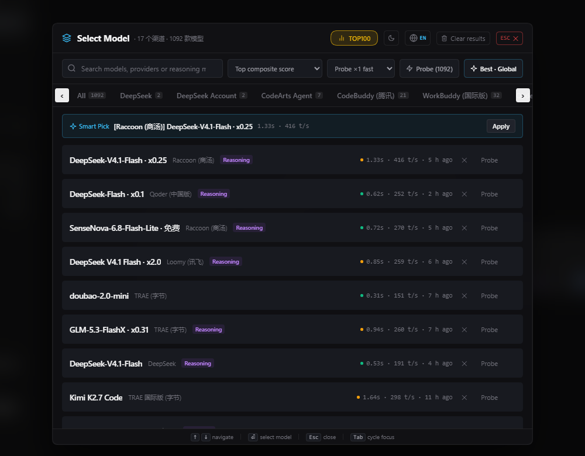

# dsh-model-master · 模型选择大师

> A Spotlight-style model switcher for **DeepSeek Harness (DSH)** — with real streaming speed probes, a live global leaderboard, and a 15-language UI.

把 DSH 原生那个狭小的模型下拉列表，接管成一块可搜索、可测速、可对照全球榜单的毛玻璃大面板。**你的模型按钮和菜单仍然是原生的** —— 插件只在"小窗口即将弹出"的那一刻无缝接管。

<p align="center">
  
</p>

<p align="center">
  
</p>

<p align="center">
  
  
</p>

---

## 目录

- [它解决什么问题](#它解决什么问题)
- [功能](#功能)
- [安装](#安装)
- [使用](#使用)
- [设计原则：绝不给假数据](#设计原则绝不给假数据)
- [配置](#配置)
- [数据与隐私](#数据与隐私)
- [HTTP API](#http-api)
- [开发](#开发)
- [发布](#发布)
- [兼容性](#兼容性)
- [致谢与许可](#致谢与许可)
- [许可证](#许可证)

---

## 它解决什么问题

DSH 原生的模型选择器是一份紧凑的下拉列表：模型一多就难找，看不出哪个快，也没有任何"这个模型到底行不行"的客观参照。

dsh-model-master 补齐三件事：

1. **找得快** — 全局搜索、按渠道分组、以及「⚡ 智能优选」直接给出当前分组里综合最优的那个。
2. **看得见快** — 对任意模型发起**真实流式请求**，测出 TTFT（首字延迟，ms）与 TPS（生成吞吐，tok/s）。
3. **有参照** — 全球百强榜，数据来自 OpenRouter 模型目录里的 Artificial Analysis 指数与 Design Arena Elo。

---

## 功能

### 接管而不取代

- 一级模型按钮、原生菜单、推理等级行**全部保持原生渲染与原生行为**。
- 只在两种时刻接管：已选模型时点击原生菜单里的「模型」项，或未选模型时点击按钮本身 —— 原生狭小列表换成插件面板，原生菜单自动关闭。
- **防顶掉**：若其它插件占用了原生模型位导致原生按钮消失，输入框工具行会自动出现备用入口；原生恢复后自动隐藏。

### 真实测速（TTFT / TPS）

- 服务端发起流式请求并**自己计时**，浏览器不参与任何数字计算。
- 支持 ×1 快速与 ×3 稳定（取中位数），把单次测速约 17–22% 的随机波动压下去。
- 批量测速逐个进行（并发 2，单条超时上限 20s），可随时停止。
- 失败**如实显示失败**，并区分超时 / 不可达 / 403 / 配额 / 无密钥等原因。

### 全球百强榜

- 最多 100 行，按 Artificial Analysis 智能指数排序，辅以代码 / Agent 指数与 Design Arena Elo。
- 点任意行 → 跳到本机搜索同名渠道，由你自己挑渠道（**不做自动匹配**，避免把榜单的模型错配到你本地的另一个渠道）。
- 每日自动同步，可手动刷新；离线时展示本地缓存并明确标注。

### 15 语言界面

English / 中文 / हिन्दी / Español / Français / العربية / বাংলা / Português / Русский / اردو / Bahasa Indonesia / Deutsch / 日本語 / 한국어 / Türkçe

- 顶部地球图标切换，选择持久化到 `localStorage`。
- 阿拉伯语 / 乌尔都语自动 RTL。

### 推理档位 FX

- 官方菜单「推理等级」行滑条：拖动渐变填充、星尘粒子、Max 档紫边辉光。
- 档位切换瞬间原生芯片上的一次性能量闪动。
- 尊重 `prefers-reduced-motion`。

---

## 安装

需要 **DSH 与 Node.js ≥ 20**。

```bash
# 装进 web profile（最常用）
dsh plugin --profile web add dsh-model-master

# 或装进你自己创建的 profile
dsh plugin --profile <your-profile> add dsh-model-master
```

`dsh plugin` 会把 pnpm 转发到 profile 目录里执行，然后把本包声明的 bundle patch（`cordis.patch.yml`）应用上去。装完**重启 DSH**（或让 HMR 自行重载）。

### 从源码安装

```bash
git clone https://github.com/<you>/dsh-model-master.git
cd dsh-model-master
npm install
dsh plugin --profile web add .
```

### 卸载

```bash
dsh plugin --profile web remove dsh-model-master
```

---

## 使用

| 操作          | 说明                                                 |
| ------------- | ---------------------------------------------------- |
| 打开面板      | 点输入框的模型按钮；已选模型时点原生菜单里的「模型」 |
| 搜索          | 直接输入模型名 / 提供商 / 推理模式                   |
| 测速单个模型  | 行尾「测」按钮                                       |
| 批量测速      | 工具栏「测速 (N)」                                   |
| 智能优选      | 工具栏「优选 · …」，在**当前作用域**内挑综合最优     |
| 看榜单        | 顶部 TOP100                                          |
| 换语言 / 主题 | 顶栏地球图标 / 明暗图标                              |

面板内键盘：`/` 聚焦搜索，`Esc` 关闭，方向键在列表里移动。

---

## 设计原则：绝不给假数据

这个插件在 v1.4 之后做过一次彻底的自我纠正，规则现在写死在代码里：

- **测速结果只由服务端产出。** 浏览器永远不写数字。历史上曾经有过基于模型名猜出来的 "gateway-ping" 估算值，那些条目启动了就会**被自动清除**（`loadResults()` 里的 purged 逻辑），旧的写入端点在服务端已经删掉。
- **失败就是失败。** 测速失败不会伪造一个看起来还行的 TPS；榜单抓不到就显示缓存并标注为离线。
- **榜单只按真实字段建行。** 没有任何 benchmark 分数的模型直接不进榜（见 `buildLeaderboardFromOpenRouter()` 与 `tests/leaderboard.test.js`）。
- **可审计。** 每次测速结果附带输出样本片段（`sample`，最多 120 字符）与 token 数来源（`tokensFromUsage`），以及实际下发的推理档位（`reasoningEffort`）。
- **测速不受档位干扰。** 探针会通过 `prepareCall` 的 `configure` 回调，把推理档位显式钉在该模型**最低**的一档 —— 否则 DSH 会沿用会话当前档位（常常是 `high`），推理模型先"想"一大段，TTFT 被拉长、TPS 被压低，测出来的是档位的速度而不是模型的速度。

---

## 配置

插件后端把数据放在 `$DSH_HOME/model-master/`（默认 `~/.dsh/model-master/`）：

| 文件                     | 内容                                                              |
| ------------------------ | ----------------------------------------------------------------- |
| `leaderboard-cache.json` | 榜单快照，含 `updatedAt` / `surveyDate` / `sourceKind` / `models` |
| `benchmark-results.json` | 本机测速结果，键为 `provider:model`                               |

没有 API key、没有硬编码路径 —— 全部由 DSH 环境动态解析。

---

## 数据与隐私

- **不收集任何遥测。** 没有分析、没有上报。
- **不出本机。** 每个 HTTP 路由都有 loopback 围栏（`isAuthorized()`）：只接受 `localhost` / `127.0.0.1` / `::1` 的 Host，并校验 `Origin`。`localhost.evil.com` 这类前缀伪造会被拒绝。
- **唯一的对外请求**是拉取 `https://openrouter.ai/api/v1/models`（玩家榜数据源），带 10 秒超时，且有去重 + 频率限制，不会变成 RPC 风暴。
- 测速请求走 DSH **自己的** LLM provider 运行时，插件本身**不接触、不存储、不打印任何密钥**。

---

## HTTP API

所有路由挂在 `/api/model-master`，仅限本机访问。

| 方法   | 路径                   | 说明                                                   |
| ------ | ---------------------- | ------------------------------------------------------ |
| `GET`  | `/catalog`             | 提供商与模型目录 + DSH 持久化的默认选择                |
| `GET`  | `/leaderboard`         | 榜单快照；过旧时后台刷新                               |
| `POST` | `/leaderboard/refresh` | 强制同步（10s 冷却）                                   |
| `GET`  | `/results`             | 本机测速结果                                           |
| `POST` | `/results/clear`       | 清一条（`{key}`）或全部（`{}`）                        |
| `POST` | `/probe`               | 真实测速：`{provider, model, samples?}`，`samples` 1–5 |

`/probe` 返回示例：

```json
{
  "success": true,
  "provider": "deepseek",
  "model": "deepseek-v4-flash",
  "ttft": 412,
  "tps": 68,
  "score": 760,
  "tokens": 20,
  "tokensFromUsage": true,
  "reasoningEffort": "low",
  "totalDuration": 705,
  "testedAt": 1761536000000,
  "sample": "1 2 3 4 5 6 7 8 9 10 11 12 13 14 15 16 17 18 19 20",
  "sampleLength": 51
}
```

---

## 开发

```bash
npm test          # node --test tests/
npm run format    # prettier --write
npm run format:check
```

测试覆盖四块：

- `tests/leaderboard.test.js` — 榜单构建纯函数（排序、截断、价格换算、变体过滤）。
- `tests/probe.test.js` — 测速档位选择（永远选最低档，绝不继承宿主默认档位）。
- `tests/contract.test.js` — 前后端线协议：客户端调用的每条路由服务端都答得出，`sourceKind` 三态对齐，loopback 围栏拒绝 `localhost.evil.com` 这类伪造，路由 disposer 确实交给了 `ctx.effect`。
- `tests/smoke.test.js` — **导入期冒烟测试**：用最小 DOM/React 桩执行 `client.js` 的真实 factory，断言它能 materialize、导出 `apply`/`inject`/`name`、注入样式，并校验 15 份词典键集一致、持久化语言真的被还原。

最后一条是重点：这个插件是 `window.__ModuleLoader__.load({id, factory})` 形式，factory 里任何一处抛错都发生在**渲染之前**，会直接连累整个 Web 启动（黑屏）。所以每次改动都必须跑它。

---

## 发布

这个包是 **DSH 组合包（bundle）**，不是应用。它靠 `dsh.bundle.patch` 挂载一行，没有独立的 CLI。

### 分发方式

三种，按推荐顺序：

| 方式        | 用户侧命令                                                      | 需要构建授权                                 |
| ----------- | --------------------------------------------------------------- | -------------------------------------------- |
| **npm**     | `dsh plugin --profile web add dsh-model-master`                 | 否（预构建产物）                             |
| **tarball** | `dsh plugin --profile web add ./dsh-model-master-1.6.2.tgz`     | 否（预构建产物）                             |
| **git**     | `dsh plugin --profile web add github:NEETnina/dsh-model-master` | **是**（拉的是源码，pnpm 需授权 build 脚本） |

因为本仓库是纯 JS、无构建步骤，git 安装虽然能跑，但**推荐 npm 或 tarball** —— 用户不必授予任何安装期脚本权限。

### 发布到 npm

```bash
npm test                          # 必须先全绿
npm pack --dry-run                # 确认打出的文件清单
npm version patch                 # 或 minor / major
npm publish --access public
```

清单里必须为真的三件事，`npm publish` 不会替你检查：

- `engines.dsh` —— 声明兼容的 DSH 范围。**省略等于对任何 DSH 版本都不设限**，DSH 会无条件放行。本包声明为 `>=0.2.0 <0.3.0`。
  注意 DSH 的校验走 `semver.satisfies(range, { includePrerelease: true })`，所以 `>=0.2.0 <0.3.0` 能正常接受 `0.2.1-rc.2` 这类预发布版本。
- `dsh.bundle.patch` —— 指向真实存在的 patch 文件，缺失会让安装直接失败。
- `icon` —— 顶层的 `icon` 字段（本包为 `./icon.svg`，≤ 256 KiB）。**只把 icon.svg 打进包里、不写这个字段，读取方是找不到它的。**

### 进插件市场（可选）

DSH **没有官方市场**。用户可以在 Plugins 页面打开实验特性 _Custom plugin indexes_，自行添加索引源。

索引是**一个 UTF-8 JSON 文件**，放任意静态托管（GitHub Pages 等）即可：

```json
{
  "format": 1,
  "title": { "en": "My DSH plugins", "zh": "我的 DSH 插件" },
  "plugins": [
    {
      "name": "dsh-model-master",
      "title": "模型选择大师",
      "icon": "icons/model-master.svg",
      "versions": [
        {
          "version": "1.6.2",
          "publishTimestamp": 1761536000,
          "source": { "type": "npm" },
          "engines": { "dsh": ">=0.2.0 <0.3.0" }
        }
      ]
    }
  ]
}
```

要点：

- `publishTimestamp` 是 **Unix 秒**，不是毫秒。
- 相对 `icon` 按索引 URL 解析，所以 `index.json` 和 `icons/` 放在同一目录最省事。
- `engines.dsh` 要与包自身一致 —— 市场只是展示，安装时 DSH 还会再校验一次。
- `source` 也可以指向 git：`{ "type": "git", "url": "https://…", "commit": "<40 位 sha>", "path": "packages/foo" }`。

### 发布前自检清单

```bash
node --check index.js && node --check client.js
npm test                                   # 25 项全绿
npm run format:check
npm pack --dry-run                         # 8 个文件，含 README / LICENSE / icon
node -e "JSON.parse(require('fs').readFileSync('package.json','utf8'))"
```

外加两件事人工确认：

1. `package.json` 里的 `repository` / `homepage` / `bugs` 指向真实的仓库地址（本仓库已填好）。
2. 起一个 throwaway profile 装一次真的：

   ```bash
   dsh plugin --profile smoke add ./dsh-model-master-1.6.2.tgz
   dsh --profile smoke --dump-config | grep dsh-model-master
   ```

   能 dump 出 `# == dsh-model-master` 这一层，就说明 manifest 被接受、layer 正确组合。

### 收录到 awesome-dsh-plugin

社区清单 [awesome-dsh-plugin](https://github.com/awesome-dsh-plugin/awesome-dsh-plugin) 同时是 dsh-market 的数据源，值得提交。

**它要求的不是改 README，而是新增一个文件**：`data/plugins/<owner>__<repo>.yml`（两个下划线）。README 由脚本生成，合并后自动重建。

完整提交说明（分类依据、CI 会查什么、描述准确性要求、可选字段的坑）见
[`docs/SUBMIT-awesome-dsh-plugin.md`](./docs/SUBMIT-awesome-dsh-plugin.md)，条目模板见
[`docs/awesome-entry.example.yml`](./docs/awesome-entry.example.yml)。

提 PR 前必须完成的三件事：

1. 仓库创建满 **1 天**（CI 硬门槛，自动检查）。
2. 给仓库打上 [**`dsh-plugin`**](https://github.com/topics/dsh-plugin) topic。
3. `package.json` 的 `repository` 指回本仓库（决定 npm 包能否与条目自动关联）。

---

## 兼容性

- **DSH**：`@deepseek-ai/dsh` 0.2.x。客户端 `dsh.client.platform = "web"`，服务端 `inject: ['llm']`。
- **Node.js**：≥ 20（用到全局 `fetch`、`node:test`）。
- **浏览器**：任意现代浏览器。样式依赖 DSH 主题令牌 `--dsw-*`，深浅色自动跟随。

客户端额外声明 `slots` / `sessions` / `remote` / `remote.session` / `modelDirectories` 五个服务 —— 这是 Cordis 的硬性要求：服务访问跟着**调用方 ctx** 走，`remote.session` 没声明的话目录解析会直接抛错（真机事故过）。

---

## 致谢与许可

### 第三方代码

`client.js` 中的推理档位滑条模块（`EffortFX`）由以下项目移植：

| 次序     | 项目                                                                                            | 许可 |
| -------- | ----------------------------------------------------------------------------------------------- | ---- |
| 直接来源 | [Bai-2008/dsh-better-panel](https://github.com/Bai-2008/dsh-better-panel)                       | MIT  |
| 上游     | [Microqian2th/dsh-codex-effort-slider](https://github.com/Microqian2th/dsh-codex-effort-slider) | MIT  |

两家项目的版权声明已并入 [LICENSE](./LICENSE)。涵盖范围、移植对照与相对上游的修改见
[THIRD-PARTY-NOTICES.md](./THIRD-PARTY-NOTICES.md)。

### 本项目原创

Spotlight 模型面板、TTFT/TPS 流式测速、百强榜、15 语言界面、防顶掉备用入口。

### 宿主

[deepseek-ai/deepseek-harness](https://github.com/deepseek-ai/deepseek-harness)。本插件仅使用其公开接口：
槽位注册、`modelDirectories` 服务、语义 DOM 锚点。

---

## 许可证

[MIT](./LICENSE)（含本项目与两个上游的版权行）
